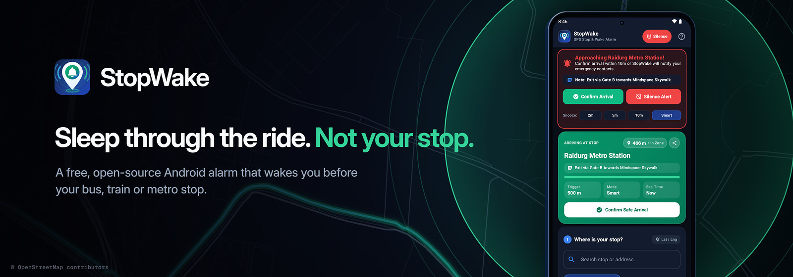
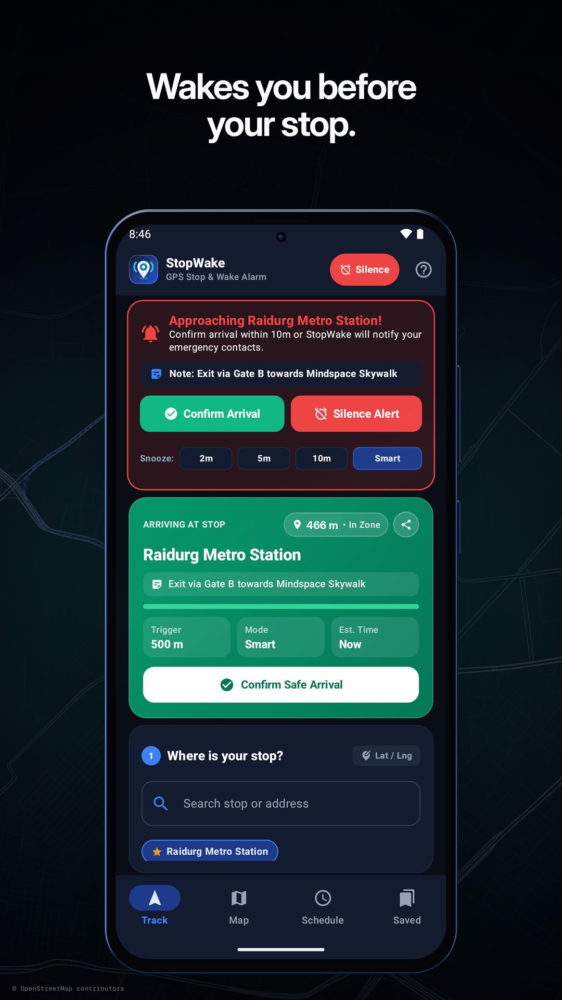
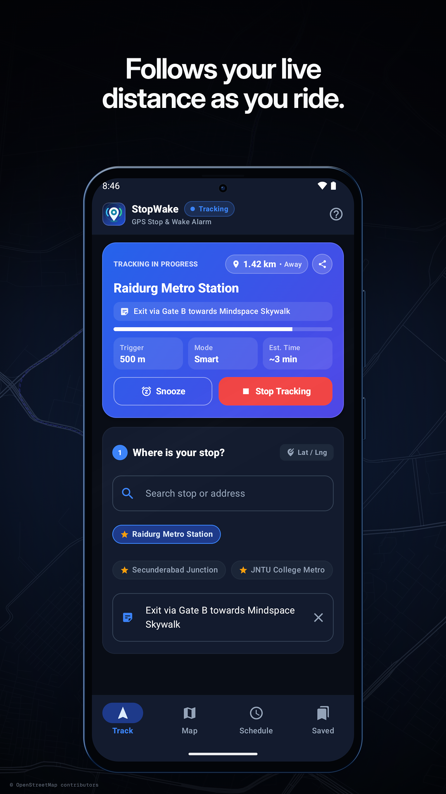
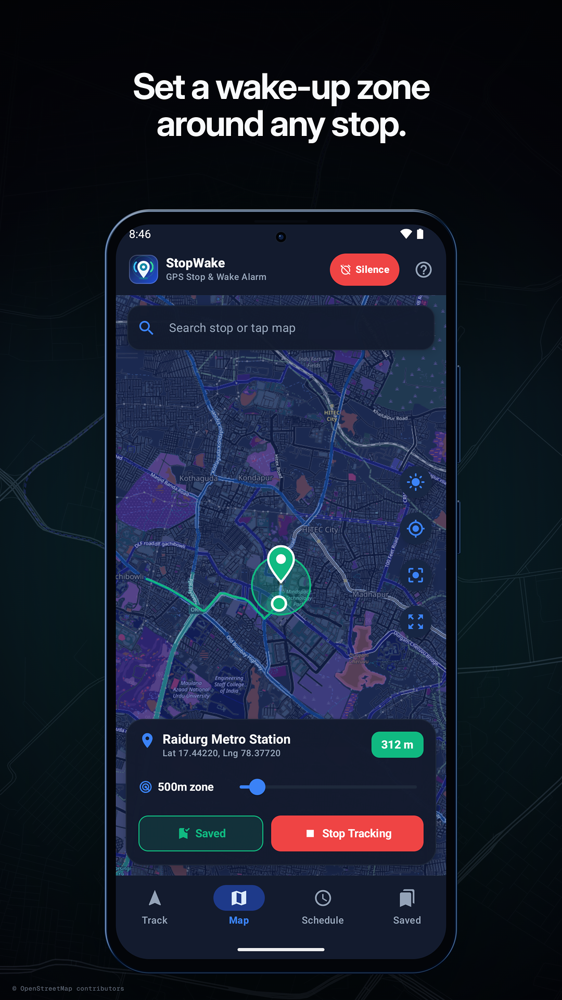
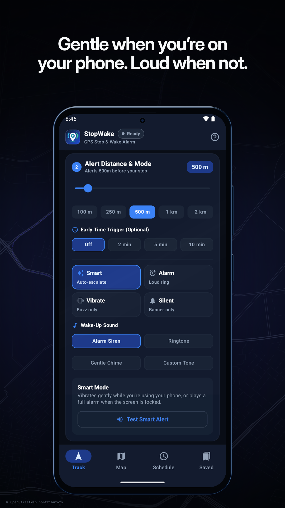
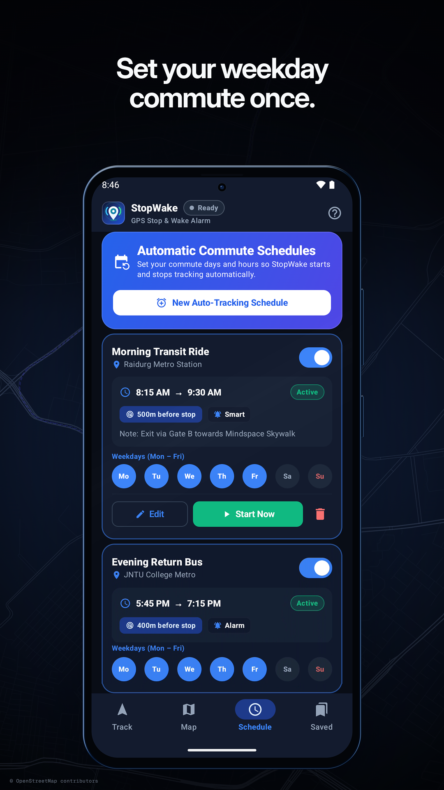
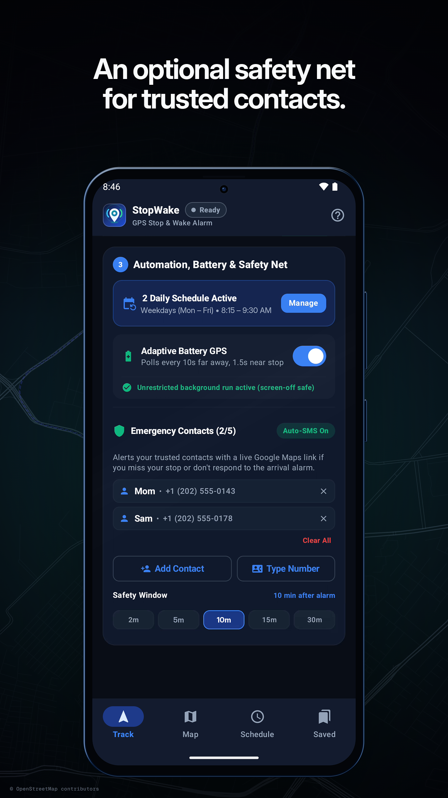
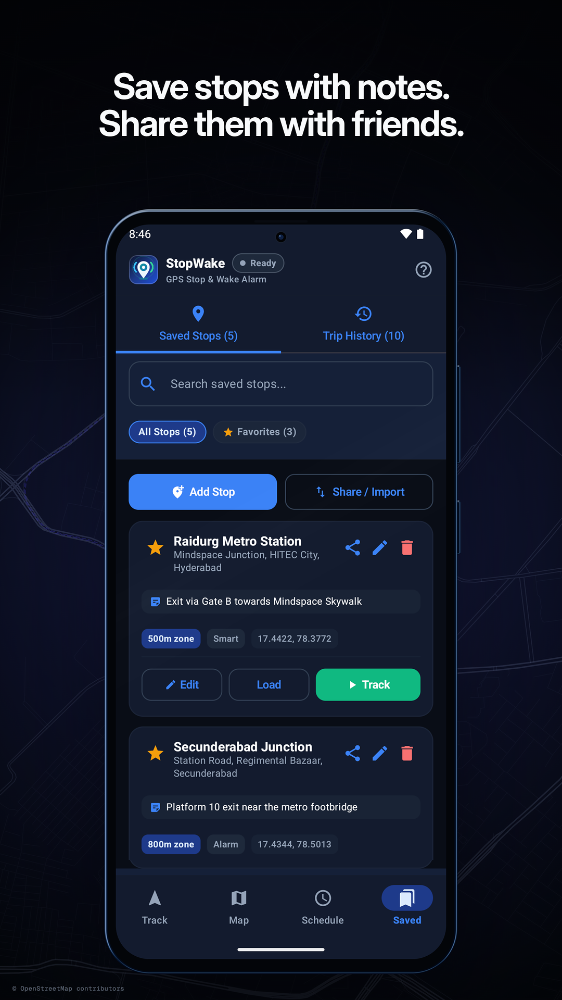
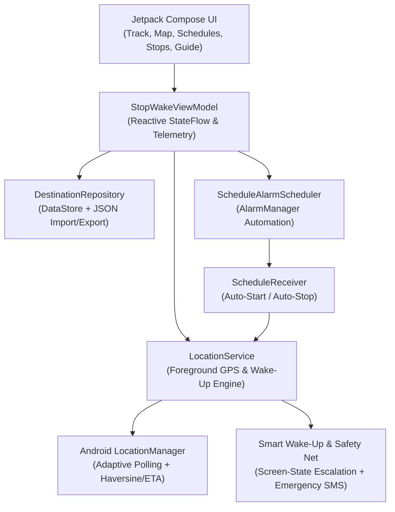

<p align="center"></p>

# StopWake: GPS Bus, Train & Metro Wake-Up Alarm

**Wake up before your bus, train, or metro stop.**

**StopWake** is a free and open-source Android location alarm built by **[Ramu Sriram](https://github.com/RamuSriram)**. It tracks your live GPS distance in the background, wakes you up before your stop, and can alert an emergency contact if you sleep through your arrival.

- **Package ID:** `io.github.ramusriram.stopwake`
- **License:** Apache License 2.0
- **Privacy & FOSS Compliance:** Built with OpenStreetMap (`OSMDroid`) and Android's native `LocationManager` (`GPS_PROVIDER`, `NETWORK_PROVIDER`, and Android 12+ `FUSED_PROVIDER`). Zero Google Play Services (`GMS`) dependencies, zero analytics, zero ads, and no accounts required.
- **Download & Auto-Update:**
  - **GitHub Releases (Direct APK):** [Download Latest `stopwake-v1.0.apk`](https://github.com/RamuSriram/StopWake/releases/latest)
  - **Obtainium:** Add `https://github.com/RamuSriram/StopWake` in [Obtainium](https://github.com/ImranR98/Obtainium) for automatic release updates.
  - **F-Droid:** Submitted to F-Droid ([RFP #4608](https://gitlab.com/fdroid/rfp/-/work_items/4608)).

---

## Why StopWake?

Millions of daily commuters and students using buses, suburban trains, and metros experience commuter fatigue and either fall asleep or get distracted, missing their stop:
- **Why clock alarms fail:** Public transit arrival times vary by 15–45+ minutes due to traffic and delays.
- **Why standard map apps aren't enough:** Standard map notifications only fire a brief chime that won't wake a sleeping commuter on a noisy bus, require starting a fixed transit route, and offer zero escalation if you sleep past your stop.

---

## Screenshots

| Arrival Wake-Up Alert | Live GPS Distance | Wake-Up Zone Map | Smart Escalation Mode |
| :---: | :---: | :---: | :---: |
|  |  |  |  |

| Weekday Commute Schedules | Emergency Contact Safety Net | Saved Stops & Sharing |
| :---: | :---: | :---: |
|  |  |  |

---

## Core Capabilities

### 1. Smart Activity-Aware Wake-Up Escalation
- **Smart Auto Mode (`SMART_ADAPTIVE`):** Detects whether your phone screen is unlocked and in your hand (`PowerManager.isInteractive` & `KeyguardManager.isKeyguardLocked`). If you are actively using your phone, StopWake vibrates gently without embarrassing you in public; if your screen is locked/off in your pocket, it escalates to a full-volume `USAGE_ALARM` wake-up siren with lockscreen turn-on (`setFullScreenIntent`).
- **4 Distinct Modes:** Smart Auto, Full Wake-Up Alarm, Rhythmic Vibration, and Silent Status Notification.
- **Custom Sounds & Reminder Notes:** Choose Built-In Alarm, Ringtone, Notification Chime, or any Custom Audio tone on your device, and attach a stop-specific reminder note (e.g., *"Exit via Gate 2, collect umbrella"*).

### 2. Dual Distance + Advance Time Triggering & Smart Snooze
- Configure your alert radius from `50 m` to `5,000 m` and/or an advance lead-time window (`2m`, `5m`, or `10m`) calculated dynamically from your live vehicle speed (`m/s`).
- **Smart Distance-Aware Snooze:** Snoozes longer when you are still far away and automatically shortens snooze intervals as you approach your stop.

### 3. Scheduled Daily Commute Automation & One-Tap Reminders
- Set recurring day-of-week schedules (`Mon–Sat`, `Weekdays`, etc.) so StopWake arms and disarms your daily college or work commute automatically.
- Fully hands-free starts need location set to **Allow all the time** (`ACCESS_BACKGROUND_LOCATION`), because Android 10+ won't let an app start location tracking from the background without it. If you skip that permission, or the OS still blocks the start, StopWake posts a high-priority one-tap **Start Tracking** notification instead of failing silently. Schedules are re-armed after a reboot (`BOOT_COMPLETED`).

### 4. On-Demand Offline Map Caching & Adaptive Battery-Saving GPS
- **On-Demand Offline Map Tile Caching:** Pre-cache OpenStreetMap tiles around your destination with one tap so your map view works smoothly on low-connectivity highway, suburban rail, and surface/elevated metro routes *(note: live GPS distance updates require satellite or station cell/Wi-Fi signal and cannot update inside deep underground tunnels without signal)*.
- **Adaptive 3-Tier GPS Polling:** Uses low-power 10-second intervals when `> 3.2 km` away, 4-second balanced polling at mid-range, and 1.5-second high-precision updates inside the final `1 km` approach.
- **Process-Kill Resilience & Wake-Lock Protection:** Persists active session state across OS `START_STICKY` memory restarts and holds a bounded `PARTIAL_WAKE_LOCK` during active proximity alerts and safety-net countdowns so Doze never defers your alarm.

### 5. Two-Stage Emergency Contact Safety Net (Up to 5 Contacts)
- **Unacknowledged Arrival Window (`2–30 min`):** Add up to 5 trusted contacts from your phonebook or via validated phone entry. If you do not tap **Confirm Arrival** or **Silence** within your chosen safety window (`2m`, `5m`, `10m`, `15m`, `20m`, or `30m`) after arriving, or if you **overshoot** past your stop after entering the alert zone, StopWake alerts your trusted contacts with a clickable live coordinate link (`https://maps.google.com/?q=lat,lng`), supporting both zero-permission **1-Tap Emergency SMS** and unattended **Background Auto-SMS**.

### 6. Portable Stop & Schedule Sharing + Pre-Built Route Packs (`route-packs/`)
- Export your saved stops and recurring schedules as a `.json` file or share them directly with friends and classmates who take the same route.
- Ready-to-import transit route packs are included in [`route-packs/`](route-packs/) (import via **Saved → Share / Import → Import from `.json` File**):
  - [`hyderabad_metro_commute.json`](route-packs/hyderabad_metro_commute.json) — Raidurg, Ameerpet, Secunderabad Junction, JNTU College, and MGBS
  - [`bengaluru_namma_metro.json`](route-packs/bengaluru_namma_metro.json) — Majestic, Whitefield (Kadugodi), Indiranagar, and Silk Board
  - [`mumbai_suburban_commute.json`](route-packs/mumbai_suburban_commute.json) — Dadar, Andheri, Thane, and Churchgate
- The sample schedules in these packs are imported switched off, so nothing starts tracking until you turn one on in the **Schedule** tab.

---

## Architecture & Project Structure



```
StopWake/
├── StopWake/                  # Android Studio / Gradle Project (SDK 35, Kotlin, Jetpack Compose)
│   ├── app/src/main/java/io/github/ramusriram/stopwake/
│   │   ├── MainActivity.kt                  # Material 3 shell, permission flow & lockscreen wake-up
│   │   ├── LocationService.kt               # Foreground GPS service, smart escalation & safety-net engine
│   │   ├── LocationUtils.kt                 # Native LocationManager, Haversine/ETA math & Nominatim geocoder
│   │   ├── ScheduleReceiver.kt              # AlarmManager daily schedule receiver + Android 12-15 fallback
│   │   ├── ScheduleAlarmScheduler.kt        # Exact & window alarm scheduling coordinator
│   │   ├── StopTrackingReceiver.kt          # Notification Confirm / Silence / Snooze action receiver
│   │   ├── data/
│   │   │   ├── SavedDestination.kt          # Saved stops, schedules, backup payload & trip history models
│   │   │   └── DestinationRepository.kt     # Jetpack DataStore + JSON import/export persistence layer
│   │   ├── viewmodel/
│   │   │   └── StopWakeViewModel.kt         # Reactive state holder & service telemetry coordinator
│   │   └── ui/
│   │       ├── components/
│   │       │   ├── StopWakeBrandLogo.kt     # Custom vector radar & wake-bell brand emblem
│   │       │   ├── OsmMapView.kt            # Interactive OSMDroid map with geofence circle & trail
│   │       │   └── ResponsiveOutlinedTextField.kt # Cursor-safe text field & responsive typography utilities
│   │       └── screens/
│   │           ├── TrackingDashboardScreen.kt # 3-step commuter dashboard & live trip hero card
│   │           ├── InteractiveMapScreen.kt  # Full-screen OpenStreetMap pin & radius selector
│   │           ├── SchedulesScreen.kt       # Recurring daily commute automation manager
│   │           ├── SavedPlacesScreen.kt     # Saved stops, favorites, JSON sharing & trip history
│   │           └── GuideAndAboutScreen.kt   # Quick start guide & developer profile
│   ├── app/src/foss/AndroidManifest.xml     # FOSS flavor permissions (SEND_SMS & battery exemption)
│   └── app/proguard-rules.pro               # R8 keep rules for Gson, DataStore & OSMDroid
├── fastlane/metadata/android/en-US/         # F-Droid & Play Store metadata, icon & screenshots
├── route-packs/                             # Ready-to-import .json transit stop & schedule packs
├── screenshots/                             # App screenshots & visual assets
├── PRIVACY_POLICY.md                        # Public privacy policy for store listings
└── LICENSE                                  # Apache-2.0 Open Source License
```

---

## Build Flavors & Run Instructions

StopWake provides two build flavors in `StopWake/app/build.gradle.kts`:
- **`foss` (Default — GitHub & F-Droid):** Includes direct automatic emergency SMS (`SEND_SMS`) and one-tap battery optimization exemption (`REQUEST_IGNORE_BATTERY_OPTIMIZATIONS`).
- **`play` (Google Play Store):** Strips `SEND_SMS` and `REQUEST_IGNORE_BATTERY_OPTIMIZATIONS` to comply with Google Play Console policies, using the pre-filled SMS composer action (`smsto:`) and standard system battery settings.

```powershell
cd StopWake
# Build FOSS debug/release APK (default)
.\gradlew.bat assembleFossDebug testFossDebugUnitTest

# Build Google Play Store release bundle/APK
.\gradlew.bat assemblePlayRelease bundlePlayRelease
```

---

## Author

Designed and developed by **Ramu Sriram**.
- GitHub: [https://github.com/RamuSriram](https://github.com/RamuSriram)
- Privacy Policy: [PRIVACY_POLICY.md](PRIVACY_POLICY.md)
